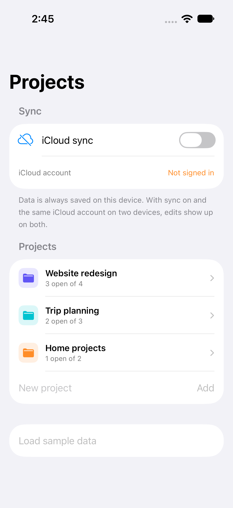
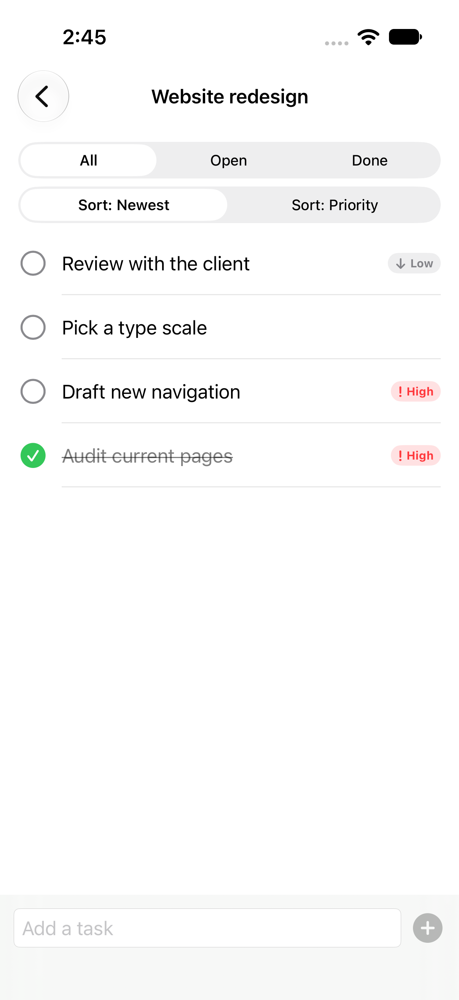
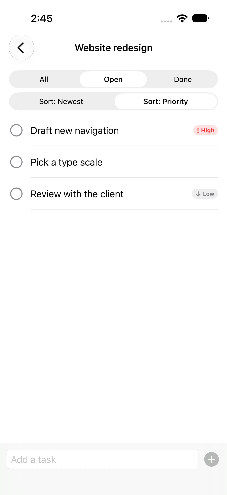
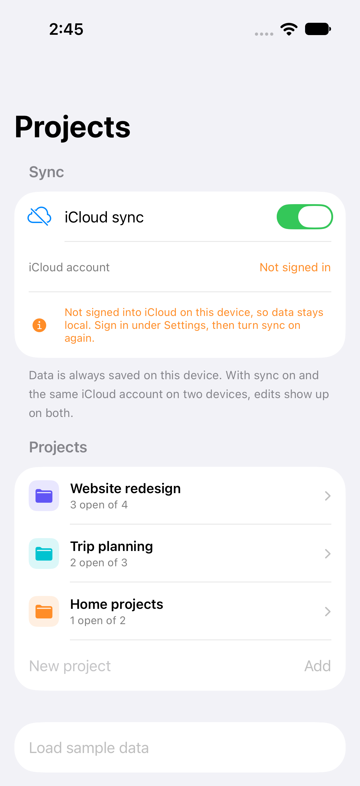

# TaskSync: SwiftData + CloudKit

[](https://github.com/VasuChovatiya/SwiftData-CloudKit/actions/workflows/ci.yml)
[](.swiftlint.yml)

A projects-and-tasks app built on SwiftData, with one switch to turn on CloudKit sync. Data is always
saved on the device first. When sync is on and two devices use the same iCloud account, edits on one
show up on the other.

| Projects | Tasks | Open, by priority | Sync without iCloud |
| --- | --- | --- | --- |
|  |  |  |  |

## Features

- **Models that follow the CloudKit rules:** `Project` and `TaskItem` have a one-to-many relationship
  with cascade delete and an inverse. Every property has a default, relationships are optional, and there
  are no unique constraints. CloudKit rejects models that break these rules.
- **`@Query` with filter and sort:** each project's tasks can be filtered (all, open or done) and
  sorted (newest or priority). The predicates and sort orders live in [`TaskQuery`](TaskSync/Persistence/TaskQuery.swift),
  so tests run them against a real store.
- **Sync on a switch:** the `ModelContainer` is rebuilt with `cloudKitDatabase: .private(...)` when sync
  is on and `.none` when it is off. Both use the same store file, so turning sync on uploads what is
  already on the device.
- **Fails safe:**
  - Sync only starts when the device is signed into iCloud. Otherwise the app explains why data stays
    local.
  - Signing out of iCloud switches the app back to the on-device store at next launch.
  - If the CloudKit store can't be opened (for example when the build has no iCloud entitlement), the
    local data stays in place and the app says why.
  - If even the on-device store fails, the app falls back to memory and says that changes won't be kept,
    instead of losing them silently.
- **Sync status:** `NSPersistentCloudKitContainer` setup, import and export events are shown as they
  happen.
- **Navigation that survives saves:** screens are pushed by each project's stable `uid` rather than the
  model object, so saving a change doesn't pop the screen.

## Requirements

- Xcode 26 or later
- iOS 17 or later

## Setup

1. Clone the repo and open `TaskSync.xcodeproj`.
2. Run the **TaskSync** scheme. Out of the box, data is stored on the device only, so no signing team is
   needed.

### Turning on iCloud sync

iCloud sync needs a paid Apple Developer account.

1. In the developer portal, create an iCloud container (for example `iCloud.com.example.TaskSync`) and
   enable iCloud with CloudKit for your App ID.
2. Copy the local config and fill in your team, bundle ID and container:

   ```sh
   cp Config/Local.example.xcconfig Config/Local.xcconfig
   ```

   This turns on the iCloud, push and remote-notification entitlements in
   [`Config/TaskSync.entitlements`](Config/TaskSync.entitlements). `Local.xcconfig` is git-ignored.
3. Run on two devices (or a device and a simulator) signed into the same iCloud account, turn on
   **iCloud sync** on both, and edit a task on one of them.

> Two-device sync has not been verified for this repo yet: it needs a registered iCloud container and
> two signed-in devices. Everything up to opening the CloudKit store is covered by the tests below.

## Testing

```sh
xcodebuild test -project TaskSync.xcodeproj -scheme TaskSync \
  -destination 'platform=iOS Simulator,name=iPhone 17 Pro'
```

- **`TaskQueryTests`:** the filter and sort predicates, run against an in-memory SwiftData store. Covers
  each filter, the sort order, keeping projects separate, and completing a task.
- **`ProjectModelTests`:** open and total counts, cascade delete, models that build with only defaults,
  and the sample data.
- **`StorageControllerTests`:** the sync switch, with the iCloud check and the container factory
  replaced by test doubles. Covers on and off, remembering the setting, no iCloud account, signing out,
  a CloudKit store that fails, and an on-device store that fails.
- **`TaskSyncUITests`:** add a project and tasks, complete one, filter to open tasks, and turn sync on
  without iCloud. The UI tests use a fresh in-memory store each run.

To capture the README screenshots again:

```sh
TEST_RUNNER_TASKSYNC_CAPTURE=1 TEST_RUNNER_TASKSYNC_CAPTURE_DIR=$PWD/Screenshots \
  xcodebuild test -project TaskSync.xcodeproj -scheme TaskSync \
  -destination 'platform=iOS Simulator,name=iPhone 17 Pro' \
  -only-testing:TaskSyncUITests/ScreenshotTests
```

## Tech stack

SwiftUI, SwiftData, CloudKit, Core Data CloudKit events, Observation, Swift 6 strict concurrency, Swift
Testing, XCTest UI tests, SwiftLint, GitHub Actions.

## License

MIT. See [LICENSE](LICENSE).
